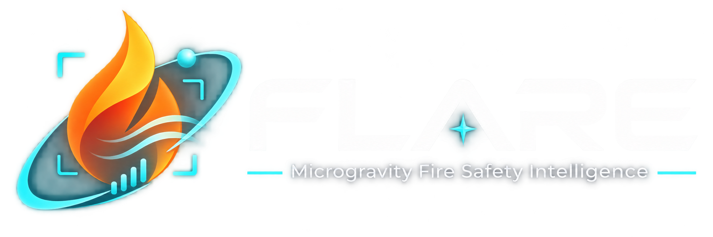
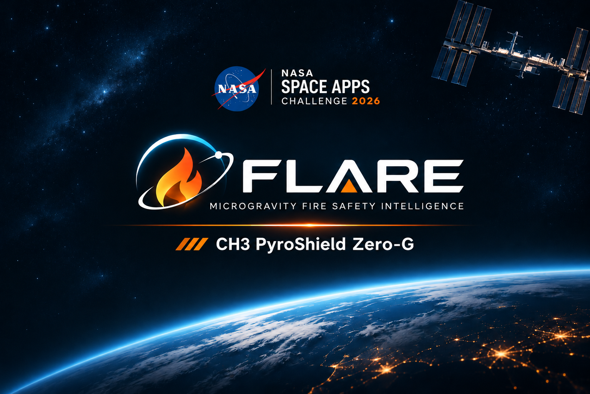
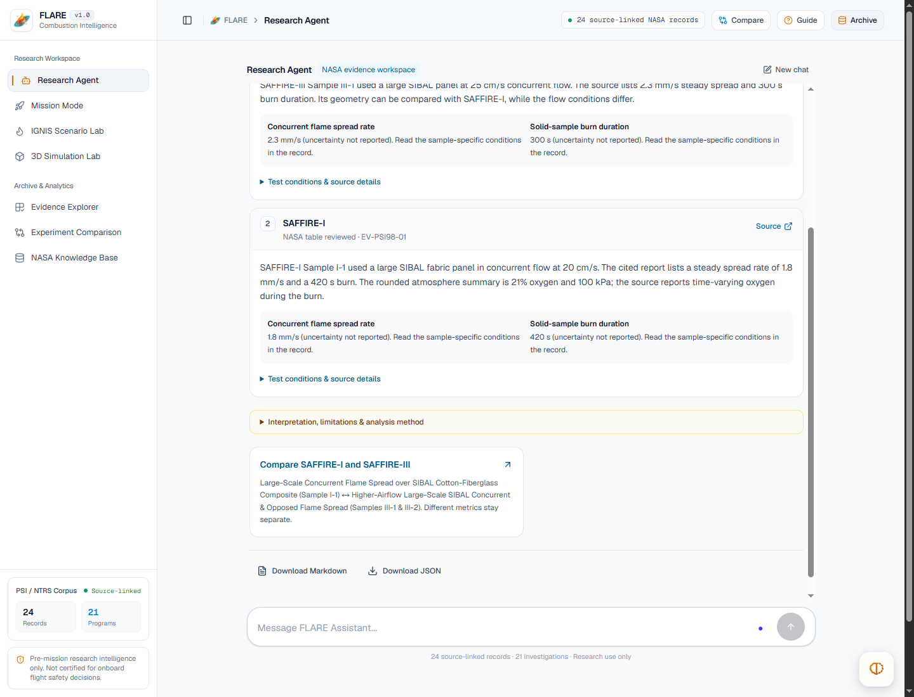
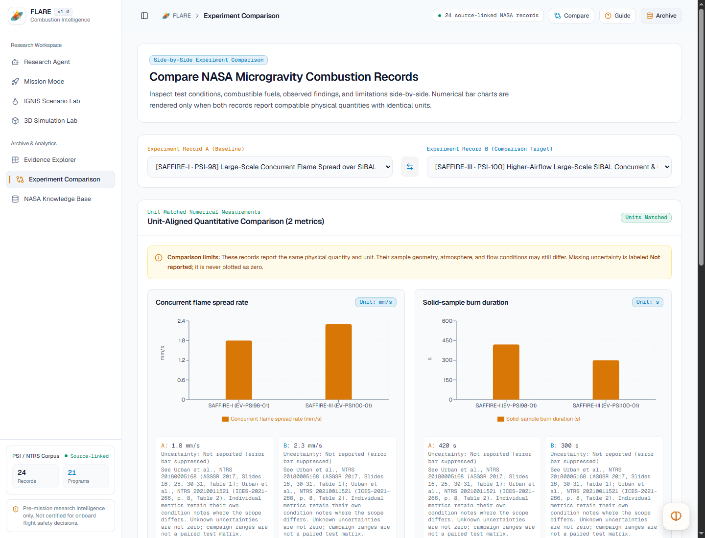
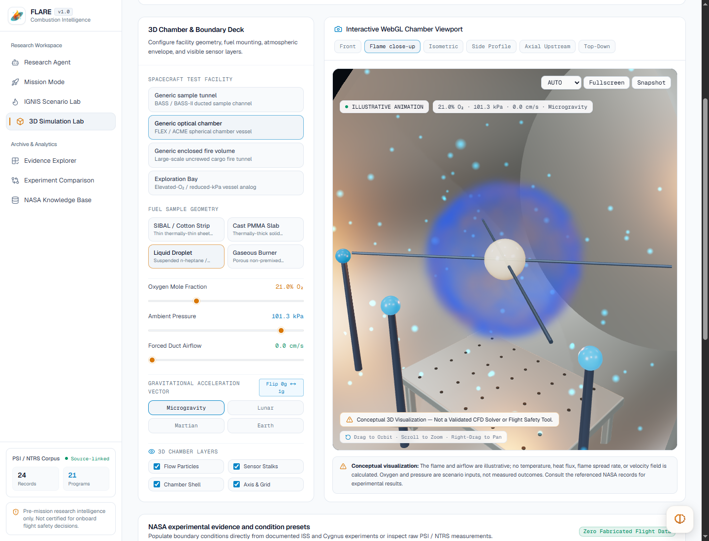

<div align="center">

<table align="center"><tr><td align="center" bgcolor="#07172A">

</td></tr></table>

### FOLLOW THE FLAME. FOLLOW THE EVIDENCE.

**A source-linked workspace for exploring NASA microgravity combustion research.**


<br />



<br />

[See the demo](#a-short-demo-path) · [Read the evidence review](docs/data-provenance.md) · [Explore all workspaces](#what-judges-can-explore)

</div>

---

## 🔥 The question behind FLARE

What does a spacecraft fire experiment actually tell us—and where does its evidence stop applying?

Combustion studies span different fuels, geometries, oxygen levels, pressures, and airflow directions. A rod regression rate is not a fabric flame-spread rate. A range across a campaign does not mean one test used every combination inside it. Missing uncertainty does not mean zero uncertainty. FLARE brings those distinctions into the same place as the interactive research tools.

### One useful example

NASA's BASS-II rod study reports a **0.0385 mm/s rod-tip regression velocity** and a separate **13.5% oxygen minimum on a multi-test flammability boundary**. Those results have different meanings and scopes. FLARE keeps them as separate quantities, preserves the source condition notes, and does not present either as a general spacecraft safety limit.

> **Research tool, not flight hardware.** FLARE is an independent pre-mission research and education project. It is not a fire detector, validated CFD solver, or flight-safety decision system.

## ✨ What judges can explore

| Workspace | What it lets you do |
|---|---|
| **Research Agent** | Ask a question in plain language, compare named investigations, and trace each selected record to its NASA source. The model selects records and existing measurement fields; scientific statements are rendered from the local corpus. |
| **Mission Mode** | Set an atmosphere, material, gravity context, and research question. See ranked evidence and export a Markdown or JSON brief. |
| **Experiment Comparison** | Compare two records. Numerical charts require compatible quantities and units; unknown uncertainty is left unreported. |
| **Evidence Explorer** | Explore oxygen/airflow coverage and gaps. Study-range overlap is labeled as range overlap, not proof of a paired test. |
| **NASA Knowledge Base** | Search and filter 24 records (9 experimental observations + 15 investigation overviews) across 21 NASA investigations, inspect provenance, and open the linked NASA page. |
| **IGNIS Scenario Lab** | Change qualitative atmosphere and flow controls and inspect corpus coverage. It does not calculate flame spread or predict extinction. |
| **3D Simulation Lab** | Change sample geometry, camera, and scene layers. The animation is illustrative; its flame and airflow are not experimental measurements or CFD. |

### 👀 A look at the running application

These are captures of the app itself, with the evidence and model limitations visible in context.

<table>
<tr>
<td width="50%" valign="top"><strong>Research Agent</strong><br />NASA-linked sample findings, conditions, and record references.<br /></td>
<td width="50%" valign="top"><strong>Experiment Comparison</strong><br />Compatible values are charted; uncertainty stays marked as not reported.<br /></td>
</tr>
<tr><td colspan="2" align="center"><strong>3D Simulation Lab</strong><br />Interactive chamber view with the illustrative-animation and conceptual-visualization disclosures in view.<br /></td></tr>
</table>

## 🧭 A short demo path

1. In **Experiment Comparison**, select SAFFIRE-I and SAFFIRE-III. Their source table reports flame-spread rates of **1.8 and 2.3 mm/s** and burn durations of **420 and 300 seconds**. The oxygen concentrations change during the burns, and the table does not provide spread-rate uncertainties. [NASA Table 1, slides 30–31](https://ntrs.nasa.gov/citations/20180005168).
2. In the **Knowledge Base**, open FLEX-008. Its 14.8-second droplet burn ends in **disruption**, not extinction. [NASA/TP-2015-216046, Table IX](https://ntrs.nasa.gov/citations/20150023456).
3. Open the **3D Simulation** to change camera and layers. Point out the on-screen disclosure that the view is conceptual.

More detail: [judge demo script](docs/demo-script.md).

*FLARE is an independent student project and is not endorsed by NASA.*

## 🧪 Evidence, AI, and known limits

The current collection contains **24 evidence records and 21 investigation overviews**. Review depth varies: some findings have been rechecked against source tables; some added overviews are based on NASA abstracts; some older metadata retains prior review. The field inventory records source links, locations, and review status. It does not claim that every field has received a fresh full-text audit.

One discrepancy remains open: NASA's SAFFIRE-V publications report different atmosphere values for Sample V-4. FLARE shows the reports separately instead of combining them into a new range. The 34% oxygen / 56.5 kPa preset is illustrative planning context, not an established SAFFIRE-V test.

AI is optional. NVIDIA, Gemini, or OpenAI can be selected through server-side configuration. The model selects existing record IDs and measurement keys; unrecognized selections are rejected. The deterministic source-based response remains available when no provider is configured or a request fails. Live checks confirmed NVIDIA and Gemini selections for one BASS-II/FLEX comparison. OpenAI returned an authentication error in that check. See the [AI disclosure](docs/ai-disclosure.md) and [sanitized provider results](docs/provider-verification.json).

## 🚀 Run locally

```bash
npm install
npm run dev
```

Open `http://localhost:3000`. AI is optional; without a provider key, the app uses its deterministic corpus-based response. For current environment variables, see [.env.example](.env.example). Keep API keys server-side and out of source control.

## 🛠️ Built with


Next.js App Router · TypeScript · Tailwind CSS · Three.js · Recharts · Zod · Vitest

## 📚 Project files

- [Scientific provenance and limitations](docs/data-provenance.md)
- [Machine-readable current evidence audit](docs/evidence-audit.json)
- [AI behavior and disclosure](docs/ai-disclosure.md)
- [Judge demo script](docs/demo-script.md)
- [Remediation and verification report](docs/remediation-report.md)
- [Public NASA Physical Sciences Informatics portal](https://psi.nasa.gov/physci/repo)
- [NASA Technical Reports Server](https://ntrs.nasa.gov/)

<details>
<summary><strong>Technical checks and optional live AI verification</strong></summary>

```bash
npm run typecheck
npm run lint
npm test -- --run
npm run build
```

AI connectivity is a separate, network-dependent check. Run `npm run verify:ai` only when you intend to make live requests using locally configured provider keys. It does not run as part of the ordinary test suite.

NASA publication data is linked to its source at the record level. Review the linked publication's reuse terms before redistributing third-party content. FLARE's interface and artwork are project assets.

</details>

## 👩‍🚀 Team PyroShield Zero-G

- **Karim El Assali** Application development and engineering
- **Hamza Sailah**     NASA experiment research and data curation.
- **Mohammed Zarwal** — Software testing and product improvement suggestions.
